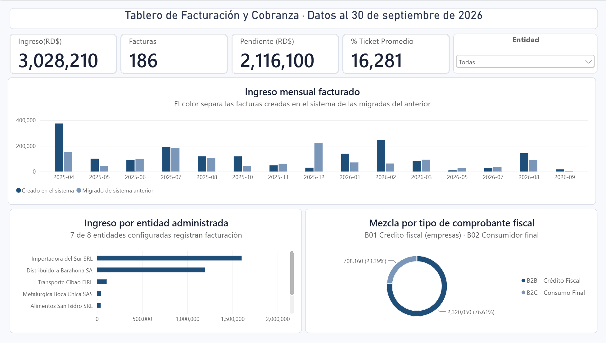
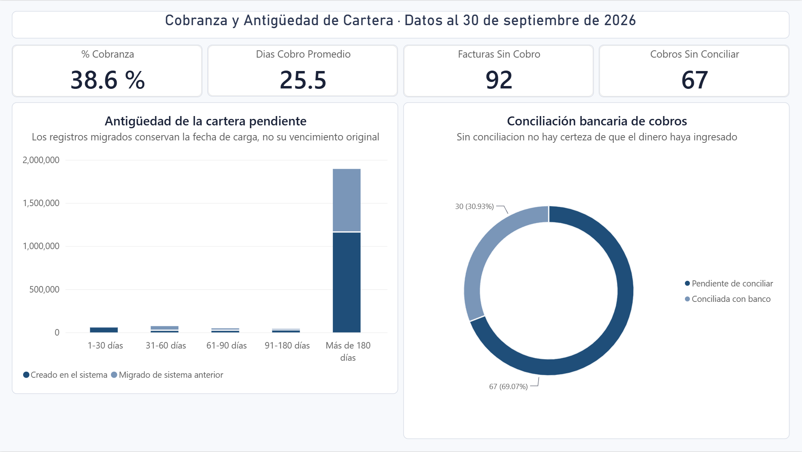
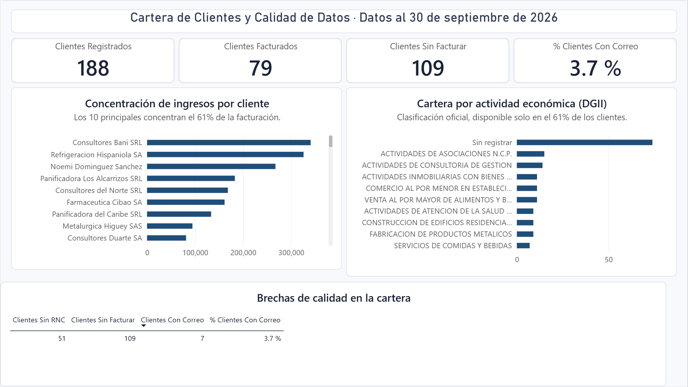

# Análisis de cartera y cobranza sobre un ERP Odoo 19

Proyecto de analítica de datos de punta a punta: desde un ERP sin reportería
hasta un tablero de Power BI que responde preguntas de cobranza.

El método completo —extracción, depuración, modelado dimensional y medidas—
está aquí, documentado y ejecutable.

---

## Sobre los datos de este repositorio

**Todo el dataset que se publica aquí es sintético.** Lo genera
`scripts/00_generar_dataset_ejemplo.py` a partir de una semilla fija. Ninguna
cifra, ningún nombre y ninguna fecha de este repositorio corresponde a una
persona o a una empresa real.

El sistema original se construyó contra un ERP en producción. Esos datos son
de su propietario y no se publican, ni enteros, ni escalados, ni
seudonimizados: no están.

Lo que sí se conserva es la **forma**. El generador reproduce los mismos
esquemas, los mismos volúmenes, las mismas asimetrías y, sobre todo, los
mismos defectos de calidad que justifican la mitad de las decisiones del
modelo. Un dataset limpio no habría servido: el trabajo de este proyecto
consiste precisamente en lidiar con datos que no lo están.

```bash
python scripts/00_generar_dataset_ejemplo.py
```

Cualquiera puede ejecutarlo y obtener exactamente los ocho archivos que están
en `dataset_ejemplo/`.

---

## El problema

Un ERP Odoo 19 Community en producción, sin un solo reporte. Para saber
cuánto se había facturado o quién debía, había que abrir el sistema y contar
a mano.

La pregunta era simple de enunciar y difícil de responder:

> ¿Cuánto nos deben, desde cuándo, y quién?

---

## Lo que había que resolver antes de poder responderla

| Obstáculo | Cómo se resolvió |
|---|---|
| El ERP expone **962 campos** entre los cinco modelos relevantes | Filtro de tres pasadas hasta dejar **83 campos con significado de negocio** |
| No existe campo que marque los registros migrados de otro sistema | Se identificaron por ventana de carga y se marcaron con una bandera propia |
| La antigüedad de cartera estaba falseada por la migración | Se separó `antiguedad_confiable` para no mezclar peras con manzanas |
| Un cobro puede saldar varias facturas y una factura recibir varios cobros | Tabla puente, para no inflar los importes |
| Campos "espejo": poblados al 100% pero redundantes | Se detectaron comparando contra su campo de origen |

---

## Arquitectura

```
Odoo 19 Community
       │
       │  XML-RPC  (solo lectura)
       ▼
  Scripts Python ──► 8 archivos CSV (modelo en estrella)
       │
       │  Programador de tareas de Windows
       ▼
   Power BI Desktop ──► 3 páginas, 30 medidas DAX
```

---

## Los scripts

Se ejecutan en orden. Cada uno responde a una pregunta distinta y ninguno
escribe sobre el ERP: **todos son de solo lectura**.

| Script | Qué hace |
|---|---|
| `00_generar_dataset_ejemplo.py` | Genera el dataset sintético de este repositorio. No toca el ERP |
| `01_conexion_odoo.py` | Autentica, confirma versión y lista los campos disponibles por modelo |
| `02_poblamiento_campos.py` | Mide qué porcentaje de cada campo está realmente poblado y cuántos valores distintos tiene |
| `02b_res_partner.py` | Lo mismo para contactos, tolerando los campos que el permiso bloquea |
| `03_diccionario_final.py` | Aplica el filtro de tres pasadas: descarta técnicos, vacíos y constantes |
| `04_resolver_revisar.py` | Clasifica los campos dudosos por familia y decide si entran |
| `05_extraccion_dataset.py` | Extrae el dataset final, ya modelado en estrella |

### Ejecutarlos

Para explorar el proyecto no hace falta ningún ERP:

```bash
python scripts/00_generar_dataset_ejemplo.py
```

Para apuntarlo a un Odoo propio:

```bash
pip install -r requirements.txt     # solo biblioteca estándar, en realidad
cp .env.ejemplo .env                # y completa tus valores
python scripts/01_conexion_odoo.py
```

Las credenciales se leen de variables de entorno. **Ningún script lleva
usuario, servidor ni clave escritos dentro.**

---

## El modelo

Ocho tablas en estrella. Dos decisiones que vale la pena explicar:

**La tabla puente.** Un cobro puede saldar cinco facturas y una factura puede
recibir tres cobros. Si se enlazan directamente, cada importe se cuenta
tantas veces como combinaciones haya. `puente_cobro_factura` resuelve esa
relación de muchos a muchos y guarda, además, el dato que de otro modo se
perdería: cuántos días pasaron entre cada factura y cada cobro.

**La bandera `valido_para_promedio`.** Algunos cobros son anteriores a la
factura que saldan: son anticipos. Un anticipo no mide velocidad de cobranza,
mide otra cosa. En lugar de dejarlo ensuciar el promedio, se marca y se
excluye explícitamente.

| Tabla | Filas | Qué es |
|---|---|---|
| `hechos_facturas` | 186 | Una fila por factura emitida |
| `hechos_lineas` | 213 | El detalle por servicio |
| `hechos_cobros` | 97 | Una fila por cobro recibido |
| `puente_cobro_factura` | 94 | Qué cobro saldó qué factura |
| `dim_clientes` | 188 | Quién compra |
| `dim_entidades` | 8 | Qué sociedad emite |
| `dim_responsables` | 14 | Quién gestiona |
| `dim_calendario` | 671 | El eje de tiempo |

---

## Las siete familias de campos

El criterio que ordenó las 962 columnas. Útil en cualquier ERP, no solo Odoo:

| Familia | Qué es | Ejemplo |
|---|---|---|
| **MONTO** | Lo que se suma | `monto_total`, `saldo_pendiente` |
| **TIEMPO** | Lo que ordena y permite comparar periodos | `fecha_factura`, `fecha_vencimiento` |
| **RELACIÓN** | Lo que conecta tablas | `id_cliente`, `id_entidad` |
| **CLASIFICACIÓN** | Lo que agrupa | `segmento_fiscal`, `metodo_pago` |
| **ESTADO** | Lo que filtra | `estado_cobro`, `conciliado_con_banco` |
| **TÉCNICO** | Lo que el ERP necesita y el negocio no | `write_uid`, `message_main_attachment_id` |
| **ESPEJO** | La traicionera: poblada al 100%, pero copia de otra | el nombre del cliente dentro del método de pago |

La familia ESPEJO es la que más tiempo cuesta descubrir y la que más ensucia
un modelo si pasa desapercibida. En este dataset el caso aparece en
`metodo_pago`: un campo de texto libre que arrastra dentro la razón social de
la sociedad que cobra. Parece una clasificación y es un texto; quien lo use
como dimensión obtiene un ranking que no significa nada.

---

## Qué tipo de problema encuentra este análisis

Las cifras que siguen son las del **dataset sintético** de este repositorio.
Se citan para que cualquiera pueda reproducirlas, no porque describan a
ninguna empresa. Lo transferible no es el número: es el tipo de pregunta que
lo saca a la luz.

**Concentración de ingreso.** El Top 10 de clientes explica el 60.6% de lo
facturado; el Top 5, el 42.4%. Pero agrupando por cliente matriz en lugar de
por cliente, los mismos diez suben al 67.0%. La diferencia son las sucursales
registradas como clientes aparte: el ERP las trata como entidades distintas y
el ranking reparte una concentración que en realidad está junta. Cuál de las
dos cifras es la verdadera depende de quién firma el cheque, y esa es una
pregunta de negocio, no de DAX.

**Cartera en bloque, no repartida.** El 94.9% del saldo pendiente está en
facturas que no han recibido ningún cobro parcial. Eso distingue un problema
de gestión de cobro de un problema de morosidad crónica, y la respuesta de
negocio es distinta en cada caso.

**Cobros sin conciliar.** 67 de 97 cobros registrados no están cruzados con
el extracto bancario. Un cobro registrado y no conciliado es una promesa, no
un ingreso: el tablero los separa en lugar de sumarlos juntos.

**El promedio que miente.** Los días de cobro promedian 25.5 y la mediana es
20.5. La diferencia la empujan unos pocos casos largos. Pero hay un sesgo peor,
y es de supervivencia: ese promedio solo puede calcularse sobre las facturas
que **sí** se cobraron. Las que llevan ocho meses sin cobrarse no aportan
ningún día al promedio, precisamente porque todavía no terminó su ciclo. El
indicador de velocidad de cobranza es, por construcción, optimista — y el
tablero lo advierte.

**Fechas sobrescritas por una migración.** 100 de las 186 facturas vienen de
un sistema anterior y su fecha de vencimiento quedó igualada a la de emisión.
Su antigüedad de cartera no se puede calcular. En lugar de esconderlo tras un
promedio, el modelo lo marca en `antiguedad_confiable` y el tablero muestra
cuánto de lo que se ve descansa sobre ese lote.

**Catálogo incompleto y duplicados por grafía.** El 10.3% de las líneas no
engancha con el catálogo de servicios: se escribieron a mano. Y hay clientes
registrados dos veces con grafías distintas (`Refrigeracion Hispaniola SA` y
`REFRIGERACION HISPANIOLA S.A.`). Las dos cosas significan lo mismo: cualquier
ranking hay que validarlo antes de darlo por bueno, porque el dato de entrada
no es único.

---

## El tablero

Tres páginas, cada una respondiendo una pregunta:

1. **Resumen de facturación** — cuánto se facturó y de qué tipo
2. **Cobranza y antigüedad de cartera** — cuánto falta por cobrar y desde cuándo
3. **Cartera de clientes y calidad de datos** — de quién depende el ingreso y
   qué tan confiable es el registro

Las medidas DAX están en `docs/medidas_dax.md`, listas para pegar. El tema
visual, en `docs/tema_powerbi.json`.







Las capturas corresponden al tablero construido sobre el dataset sintético de
este repositorio. El archivo `.pbix` no se publica.

---

## El diccionario de campos

`docs/diccionario/` lista los 123 campos que sobrevivieron al filtro, uno por
modelo de Odoo, con su familia, su significado de negocio, la pregunta que
responde y el riesgo de calidad que hay que vigilar en cada uno.

Es un catálogo del **modelo de datos de Odoo 19**, no el perfilado de ninguna
instalación concreta: no lleva porcentajes de poblamiento ni conteos, porque
esos dependen de la base de cada quien. Para obtener los suyos, cualquiera
puede ejecutar `02_poblamiento_campos.py` y `03_diccionario_final.py` contra
su propio Odoo.

---

## Estructura

```
.
├── scripts/              el generador y los 6 scripts de extracción
├── dataset_ejemplo/      los 8 CSV sintéticos
├── docs/                 metodología, diccionario, medidas DAX, tema
├── capturas/             las tres páginas del tablero
├── .env.ejemplo          plantilla de configuración
├── .gitignore
└── README.md
```

---

## Nota sobre el acceso

Todo el trabajo se hizo con un usuario propio y una clave API generada bajo
esa cuenta, con permisos de lectura. Nunca con credenciales prestadas de otra
persona.

No es formalismo: si la actividad queda registrada a nombre de alguien más,
el trabajo no es demostrablemente tuyo y la trazabilidad del sistema se
rompe.

---

## Licencia

MIT. Ver `LICENSE`.
